<picture>
  <source media="(prefers-color-scheme: dark)" srcset="./assets/dark.svg">
  <source media="(prefers-color-scheme: light)" srcset="./assets/light.svg">
  
</picture>

 

## 👋 Hi, I'm Robbens

I'm an **IT / IAM professional** building hands-on experience with identity, access, and cloud infrastructure in Microsoft environments. Every project below is a documented, step-by-step lab.

## 🔐 Identity & Access Management Projects

| Project | Focus | Status |
|:--|:--|:--|
| [IAM SSO & Identity Lifecycle](https://github.com/RPetitmay/iam-sso-lifecycle-lab) | OIDC, MFA policy, group-based access, and troubleshooting | 🟡 In progress |

## 💻 Information Technology Projects

| Area | Project | Skills | Status
|:--|:--|:--|:--|
| 🎫 **osTicket** | [Prerequisites & Installation](https://github.com/RPetitmay/osticket-prereqs) | Azure VMs, IIS, RDP | 🟢 Complete
| | [Post-Installation Configuration](https://github.com/RPetitmay/post-install-config) | Roles, departments, teams, SLAs | 🟢 Complete
| | [Ticket Lifecycle Examples](https://github.com/RPetitmay/ticket-lifecycle) | Intake, assignment, resolution | 🟢 Complete
| ☁️ **Microsoft Azure** | [On-premises Active Directory in Azure VMs](https://github.com/RPetitmay/configure-ad) | AD DS, DNS, file shares, permissions, PowerShell | 🟢 Complete
| | [NSGs & Inspecting Network Protocols](https://github.com/RPetitmay/azure-network-protocols) | Wireshark, NSGs, SSH, RDP, DNS, ICMP | 🟢 Complete
| | [Windows Backup & Restore](https://github.com/RPetitmay/windows-backup-restore) | Recovery Services Vault, disaster recovery | 🟢 Complete
| | [Microsoft Office 365 Troubleshooting](https://github.com/RPetitmay/office365-troubleshooting) | Outlook, OneDrive, SharePoint | 🟢 Complete
| 🔒 **VPN** | [VPN Setup & Usage in Azure VMs](https://github.com/RPetitmay/vpn-setup) | Proton VPN, IP/geolocation testing | 🟢 Complete

## 🛠️ Engineering Stack

 

## 🎓 Certifications

<picture>
  <source media="(prefers-color-scheme: dark)" srcset="./assets/certs.svg">
  <source media="(prefers-color-scheme: light)" srcset="./assets/certs-light.svg">
  
</picture>

  

## 🤝 Connect

